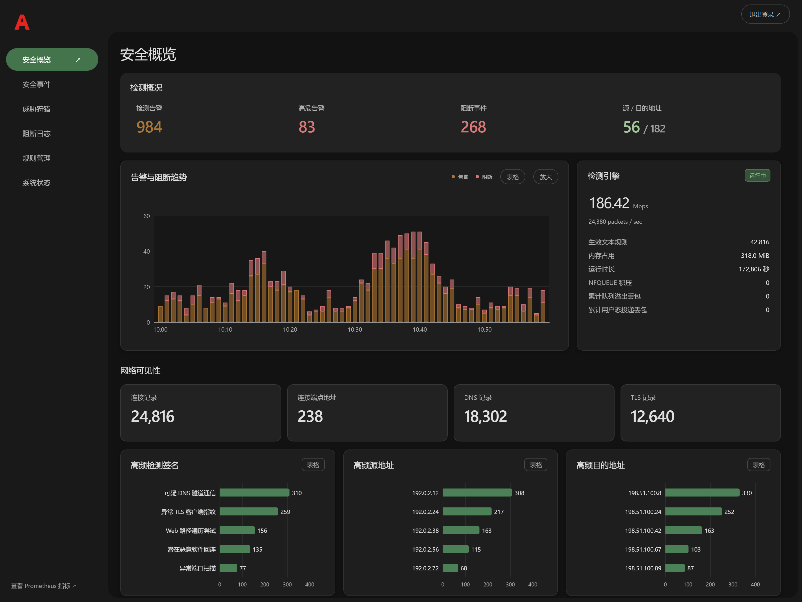

# AEGIS

Angular 与 Go 实现的 Snort 3 网络检测控制台，提供安全概览、事件调查、协议日志、签名来源、签名草稿、封禁与告警抑制管理。后端使用 Go 1.27.3、有界多核任务和内置 SQLite；前端针对桌面浏览器，静态资源本地打包，不依赖 CDN。

## 界面预览

[](docs/images/dashboard.png)

使用合成数据渲染的实际桌面界面，展示检测概况、告警与阻断趋势、引擎状态及网络可见性。地址采用文档保留地址，所有指标仅用于演示，不代表真实设备数据或实测性能。点击图片可查看原图。

## 本地预览

构建工具需要 Python 3.13 或更新版本，以及用于获取依赖的网络环境。Go 工具链自动校验与获取；Windows 使用已准备 GCC 交叉编译环境的 WSL Debian：

```sh
python -B preview.py
```

打开 http://127.0.0.1:19090，账户 `admin`，密码 `preview-only`。预览通过真实 Go 请求路径运行，使用仅存在于测试程序的合成数据夹具，只绑定回环地址，退出后清理，不连接检测设备。

## 构建

在 PowerShell 执行，输出目录必须在源码树之外：

```powershell
.\deploy.ps1 -BuildOnly -OutputDirectory "$env:TEMP\ndr-console-release"
```

Linux、macOS 或 Windows 也可单独构建静态资源：

```sh
python3 -B build_frontend.py --output /var/tmp/ndr-console-static
```

构建器按锁文件安装依赖，并校验清单固定的 Node.js、npm 与 ATT&CK 数据。依赖、缓存与生成目录只存于临时工作区。

## 部署

运行环境为 Linux 与 systemd。运行服务与生产维护入口使用 Go，目标机无需 Go 工具链；Python 3.13 或更新版本仅供构建和安装部署工具使用。Snort 3、LibDAQ 与签名独立安装，签名更新由项目内的 Go 更新器执行。面板源码不限定目标 CPU 架构；可选引擎交叉编译工具仅覆盖清单声明的 ARM64 目标。

首次接入、更新和回滚见 [部署说明](README-deploy.md)，功能说明见 [使用说明](IPS-使用说明.md)。本地模型总结、签名建议及取消行为见 [本地模型研判](docs/local-llm.md)。已有安装的更新必须显式指定 SSH 目标：

```powershell
.\deploy.ps1 -Target root@sensor.example -UpdateBackend
```

仓库不包含第三方二进制、引擎发行包、更新器修改、第三方签名包或真实运行数据库。

QUIC 握手及可见路径追踪可选接入受限的 Wireshark 观察组件，安装和能力边界见 [QUIC 观察](docs/quic-observer.md)。事件搜索语言的选型依据见 [事件搜索](docs/event-search.md)。

## 测试

完整后端回归应在 Linux 或 WSL 中执行，部分测试需要 Unix 套接字与文件锁：

```sh
python3 -B tests/run_backend.py discover -s tests -p 'test_*.py'
python3 -B build_tools/go_backend.py -- test -race -count=1 -timeout=120s ./...
```

生产构建包含前端产物一致性与组件回归。桌面浏览器回归使用 `tests/run_browser_regression.py --release <发布包>`，Chrome 路径可用 `CHROME_PATH` 指定。测试在开发机上使用合成数据或临时副本。维护约定见 [AGENTS.md](AGENTS.md)。提交公开源码前执行 `python -B tests/check_public_source.py`，检查暂存区中的凭据、个人路径、私网主机地址和运行产物。

桌面回归通过真实 Go 入口验证登录、六个页面、查询、会话详情、分页和签名操作；仅启动回环预览和无界面桌面 Chrome。模型推理及取消行为由 Go 回归验证。

## 许可

面板独立实现采用 [MIT](LICENSE)。Snort 引擎补丁单独遵守上游 GPL-2.0-only，范围见 [第三方声明](THIRD_PARTY_NOTICES.md)。Snort、Cisco、Talos、MITRE 等名称用于说明来源与兼容性，不表示官方关联。
